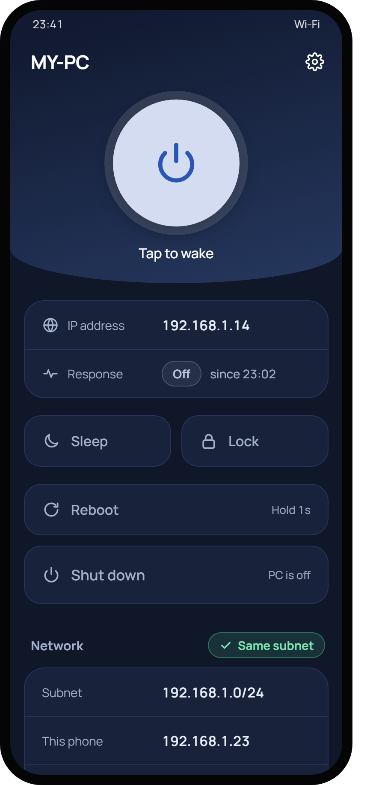
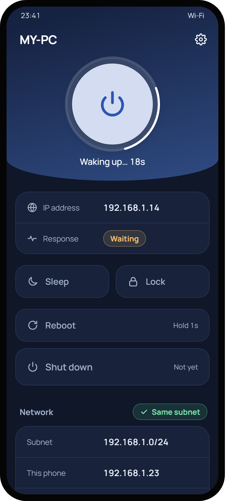
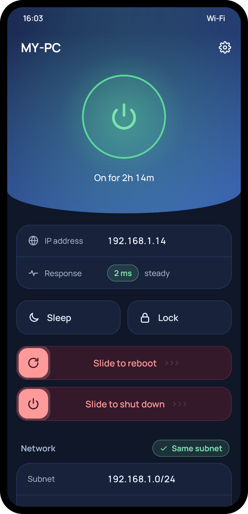
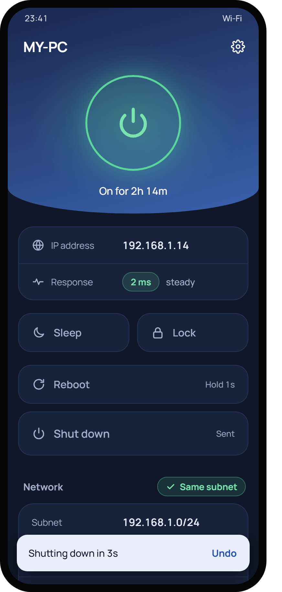
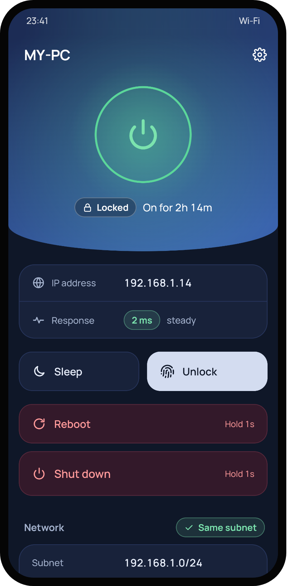
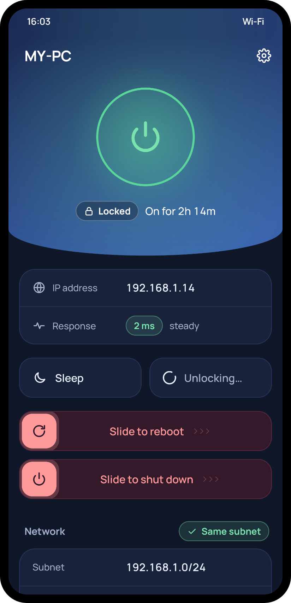

# Wake

Wake up, shut down, reboot, sleep and lock your Windows PC from your Android phone, over your home Wi-Fi. Optionally, unlock it with your phone's fingerprint sensor.

## Download

From the [latest release](https://github.com/JanoAngulo/wake-on-lan/releases/latest):

| File | Install on |
|---|---|
| **Wake.apk** | your Android phone (Android 13 or newer) |
| **WakeAgent-Windows.zip** | your Windows 10/11 PC. Includes everything it needs, no Java install required |

## Set up (about 5 minutes)

### 1. On the PC

1. Unzip **WakeAgent-Windows.zip** anywhere, for example in Downloads.
2. Double-click **Install Wake Agent.cmd** and choose **Yes** when Windows asks for permission.
3. When it says **Done**, look for the **green power icon** in the system tray at the bottom right. Click the **^** arrow if it's hidden.

The installer:
- turns on Wake on Magic Packet for your wired network adapter,
- turns off Windows Fast Startup, so Shut down is a real shutdown the PC can wake from,
- allows the agent through Windows Firewall for your local network only,
- starts the agent every time you log in.

You only do this once. Run it again to update; run **Uninstall Wake Agent.cmd** to remove everything.

**Waking from shutdown also needs one BIOS/UEFI setting.** Restart, open the BIOS setup (usually Delete or F2 at startup), turn on **Wake on LAN** (sometimes called "Resume by PCI-E device" or "Power on by PCI-E"), and turn off **ErP Ready** or **Deep Sleep** if your board has it.

### 2. On the phone

1. Copy **Wake.apk** to the phone and open it. Allow installing from that source if Android asks.
2. Connect the phone to the **same Wi-Fi** as the PC and open **Wake**. It finds your PC on its own.
3. On the PC, right-click the green tray icon and choose **Pair phone…**. A 6-digit code appears for 2 minutes.
4. In the app, tap your PC, type the code and tap **Pair**.

That's it. The same steps are in the app under **Settings → How to connect**.

## Using it

<table>
  <tr>
    <td align="center" width="25%"></td>
    <td align="center" width="25%"></td>
    <td align="center" width="25%"></td>
    <td align="center" width="25%"></td>
  </tr>
  <tr>
    <td align="center"><b>1. Tap to wake</b></td>
    <td align="center"><b>2. Wait for it</b></td>
    <td align="center"><b>3. It's on</b></td>
    <td align="center"><b>4. Shut down, or undo</b></td>
  </tr>
</table>

1. **Wake.** When the PC is off, tap the big power button.
2. **Wait.** The ring spins while the PC boots, usually 20 to 40 seconds. If it hasn't answered after 90 seconds, the app tells you and offers to retry.
3. **Use it.** Once the PC is on, the button turns into a green ring showing how long it's been up. **Sleep** and **Lock** work with a tap.
4. **Turn it off.** **Reboot** and **Shut down** need a slide to the end, so a stray tap or a scroll can't close your apps. You then get 3 seconds to tap **Undo**.

Have more than one PC? Tap the PC name at the top to switch, or use **Settings** to add another one.

## What it does

- **Wake** the PC from full shutdown or sleep with one tap
- **Shut down and reboot** with slide-to-confirm and a 3-second Undo. These are forced, so open apps close.
- **Sleep and lock** with one tap
- **Unlock with your fingerprint** (optional): the locked PC signs you in without typing your password
- **Live status**: on, off, waking, locked, shutting down, with response time and uptime
- **Several PCs**, folders and "Wake all"
- Works with TalkBack, large text and reduced motion

## Good to know

- **Home network only.** The phone and PC must be on the same network.
- **Use a network cable on the PC.** Most Wi-Fi cards can't wake a PC from shutdown.
- **Log in after waking.** Waking works any time, but shut down, reboot, sleep and lock work once you're logged in on the PC, because the agent runs in your session. With sign-in after shutdown on, the app can sign you in first (see [Fingerprint unlock](#fingerprint-unlock-optional)).
- **Only your phone can send commands.** Pairing uses a key exchange confirmed by the 6-digit code, and every command is signed. Other devices on your Wi-Fi can't shut your PC down.

## Fingerprint unlock (optional)

When the PC is locked (after Lock, or after waking from sleep), tap **Unlock** in Wake and touch the fingerprint sensor. The PC unlocks without you typing anything.

<table>
  <tr>
    <td align="center" width="25%"></td>
    <td align="center" width="25%"></td>
  </tr>
  <tr>
    <td align="center"><b>1. Locked: tap Unlock</b></td>
    <td align="center"><b>2. Touch the sensor, it unlocks</b></td>
  </tr>
</table>

- **Turn it on:** run **Install Wake Agent.cmd** and answer `y` to *Turn on fingerprint unlock?* It adds a "Wake" option to the lock screen. Your usual password and PIN options stay.
- **On the phone:** Settings → your PC → **Fingerprint unlock**. Enter the Windows password once: your Microsoft account or local account password, **not the PIN**.
- **Where the password lives:** only on the phone, locked by your fingerprint (the phone's PIN works as backup). It's sent to the PC encrypted and never saved there.
- **After a shutdown too (optional):** answer `y` to *Allow fingerprint sign-in after shutdown?* in the installer. Then after you wake the PC from shutdown, the app shows **On, at sign-in** and Unlock signs you in at the Windows sign-in screen. Without it, sign in on the PC as usual after a shutdown or reboot.
- If the PC rejects the saved password (you changed it), Wake deletes it and asks again. It never retries on its own, so it can't lock your account.

It needs two Windows settings:

- **"Only allow Windows Hello sign-in for Microsoft accounts" must be off** (Settings → Accounts → Sign-in options). When it's on, Windows hides every sign-in option except Windows Hello, Wake included. `setup.ps1 -Check` tells you if it's on.
- **Your Microsoft account needs a password.** A passwordless account has no password to send, so turn passwordless off at account.microsoft.com → Security.

After a reboot you'll also see the Wake option on the sign-in screen. It's never picked by default. Without sign-in after shutdown it does nothing there, so sign in as usual.

**How sign-in after shutdown stays safe.** A small program, `WakeSignIn.exe`, starts at boot as the built-in LOCAL SERVICE account with its own identity and no admin rights. It listens on port 47615, from your home network only, and only while the sign-in or lock screen is up. It accepts just two requests from your paired phone and can't shut down, pair or do anything else. It holds a separate key derived from the pairing secret, not the secret itself. Your password still lives only on the phone. Turn on **BitLocker** (Settings → Privacy & security → Device encryption) so a stolen drive gives nothing away; `setup.ps1 -Check` shows whether it's on.

To remove it, run **Uninstall Wake Agent.cmd**. If Windows is still using the file, it's deleted on the next restart.

## Privacy

The app shows the same details under **Settings → Privacy & security**.

- **Only on your local network.** No account, no ads, no analytics, no crash reports, nothing on the internet. Wake talks to your paired PCs, plus the broadcasts that find and wake them, which other devices on the same Wi-Fi can see.
- **On the phone:** your PCs' names, IP and MAC addresses; the pairing key, encrypted by the Android Keystore; and, if you use fingerprint unlock, your Windows password, locked behind your fingerprint. Android backup and phone-to-phone transfer are off for Wake.
- **On the PC:** the pairing key, readable only by your Windows account; with sign-in after shutdown, a separate sign-in key that can't send commands, in a folder only your account, administrators and the sign-in program can open; and logs with local addresses and results, never your password.
- **Removing everything:** uninstall the app, and run **Uninstall Wake Agent.cmd** on the PC from each Windows account that used Wake.

## Troubleshooting

| Problem | Try this |
|---|---|
| The PC doesn't wake from shutdown | Check the BIOS setting above. On the PC, run `powershell -ExecutionPolicy Bypass -File pc-setup\setup.ps1 -Check` inside the unzipped folder; every line should say yes. |
| "No PC answered" when searching | Make sure the green tray icon is there and the phone is on the same Wi-Fi. |
| "On, waiting for agent" | The PC is on but nobody is logged in yet. Log in. |
| Pairing fails | Start pairing again from the tray icon; the code lasts 2 minutes and works once. |
| No **Unlock** button, or "Install the unlock module on the PC first" | Run **Install Wake Agent.cmd** again and answer `y` to *Turn on fingerprint unlock?* |
| No Wake option on the lock screen | Turn off "only allow Windows Hello sign-in" (see [Fingerprint unlock](#fingerprint-unlock-optional)). |
| No **Unlock** after waking from shutdown ("On, waiting for agent") | Run `setup.ps1 -Check` and look at the *Sign-in after shutdown* rows; if it isn't installed, run **Install Wake Agent.cmd** again and answer `y`. Its log is `C:\ProgramData\Wake\logs\signin.log`. If the PC got a new IP address, give it a fixed one (a DHCP reservation) on your router. |
| "Couldn't save" when saving the password | Set up a screen lock and at least one fingerprint on the phone first. |

The agent's log is at `%LOCALAPPDATA%\Wake\agent.log`.

---

## For developers

### How it works

```
Phone ──UDP broadcast, magic packet─────────▶ PC network card   (wake: works while the PC is off)
Phone ──UDP broadcast, discovery────────────▶ agent             (find PC: name, IP, MAC)
Phone ──HTTP, HMAC-signed requests──────────▶ agent             (status, shutdown, reboot, sleep, lock)
Phone ──HTTP, signed + encrypted /unlock────▶ agent ──named pipe──▶ credential provider DLL ──▶ lock screen
Phone ──HTTP, /signin/* (sign-in key)───────▶ WakeSignIn ──named pipe──▶ credential provider DLL ──▶ sign-in screen
```

- **Pairing:** an X25519 key exchange confirmed by the 6-digit code. The phone proves the code first; the agent's proof comes back only afterwards, so the traffic gives nothing away for offline guessing.
- **Commands:** HMAC-SHA256 over the method, path, timestamp, a one-time nonce and the body. The agent rejects bad signatures, requests more than 30 seconds old and reused nonces. Clock corrections are accepted only with an HMAC proof from the agent.
- **Shutdown and reboot** run 3 seconds after the request, which is what makes Undo possible. **Sleep** never hibernates. **Lock** needs the agent running in the logged-in session.
- **Unlock:** the phone's Android Keystore releases the password only after a fingerprint (or the phone's PIN). The password is AES-GCM encrypted with a key derived from the pairing secret through HKDF, and the ciphertext is bound to the request's nonce. The agent decrypts it and passes it over `\\.\pipe\wake-unlock` to `WakeCredentialProvider.dll`, a Windows credential provider that LogonUI loads as SYSTEM. It submits the password and reports Windows' answer back. The agent only writes to the pipe if SYSTEM owns it. The DLL does no networking, stores nothing on disk and sits in `C:\Program Files\Wake`, where only administrators can write.
- **Sign-in after shutdown:** `WakeSignIn.exe` (same Kotlin module, second launcher) runs from the startup task "Wake Sign-in" as LOCAL SERVICE with `ProcessTokenSidType Unrestricted` (its own `NT TASK\Wake Sign-in` SID) and only SeChangeNotifyPrivilege. It binds TCP 47615 only while the pipe exists and serves `/signin/status` and `/signin/unlock`, signed and sealed with `HKDF(secret, "wake-signin-v1")`, never the pairing secret. Bodies over 4 KiB get 413. The tray agent writes that key to `C:\ProgramData\Wake\signin` with DPAPI machine scope; the folder grants only SYSTEM, Administrators, the installing user and the task SID. The DLL adds the task SID to its pipe DACL and picks the installing user's tile (`HKLM\SOFTWARE\Wake\SignInUserSid`). Design: [docs/specs/2026-10-28-cold-boot-sign-in-design.md](docs/specs/2026-10-28-cold-boot-sign-in-design.md).
- **Ports:** UDP 9 (Wake-on-LAN), TCP 47613 (agent API), UDP 47614 (discovery), TCP 47615 (sign-in, only while the sign-in or lock screen is up). TCP 135 is only used to check that the PC is up.

### Building

Requirements: JDK 21 and the Android SDK (platform 36). Gradle is included through the wrapper.

Use the latest JDK 21 update for releases: the Java runtime bundled with the Windows agent, which also runs the sign-in program before anyone signs in, is copied from the JDK that runs Gradle (`JAVA_HOME`).

```bash
./gradlew test                    # unit tests for every module
./gradlew :app:assembleRelease    # app/build/outputs/apk/release/app-release.apk
credential-provider\build.cmd     # WakeCredentialProvider.dll (needs VS 2022 Build Tools, C++ workload)
./gradlew :agent:agentZip         # build/release/WakeAgent-Windows.zip (agent + bundled Java runtime + unlock DLL)
./gradlew :agent:agentJar         # agent/build/libs/wake-agent.jar (runs on an installed JDK 21)
```

Release builds are signed with the keystore named in a `keystore.properties` file in the project root, which you create yourself and which is git-ignored. Without it, the debug key is used. See [docs/RUNBOOK.md](docs/RUNBOOK.md).

In a source checkout, **Install Wake Agent.cmd** builds and installs the jar version if the bundled `WakeAgent` folder isn't next to it.

### Project layout

| Path | What's in it |
|---|---|
| `protocol/` | Shared Kotlin: magic packet, wire messages, request signing, pairing crypto |
| `agent/` | Windows agent: HTTP API, discovery, tray icon, power actions, packaging |
| `app/` | Android app: Jetpack Compose UI, status logic, storage, fingerprint-gated password |
| `credential-provider/` | C++ Windows credential provider for fingerprint unlock, with its tests |
| `pc-setup/` | Install, update and uninstall script |
| `docs/` | Design spec, implementation plan, clickable design prototype, runbook |
